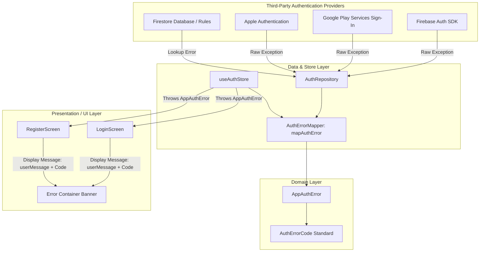

# Authentication Error Architecture & Code Catalog

## 1. Executive Summary

In high-reliability church and community mobile applications, authentication failures are one of the most critical touchpoints for user frustration. When users encounter vague messages like `"Unknown error"` or raw system traces like `FirebaseError: [auth/internal-error]`, users feel confused and support teams cannot diagnose the issue.

This architecture introduces:
1. **Zero Raw or Unknown Errors**: Every failure is translated into an empathetic, human-friendly message paired with a deterministic **Support Reference Code** (e.g., `AUTH-1001`, `AUTH-9001`).
2. **Instant Support Traceability**: A church member can report `AUTH-3001` or `AUTH-2001` to their pastor, church admin, or help desk, who can immediately identify the root cause without requesting device logs.
3. **Domain Layer Decoupling**: Raw SDK errors from Firebase Auth, Google Sign-In, Apple Authentication, and Firestore are captured and normalized via `mapAuthError` into strongly-typed `AppAuthError` instances.
4. **Deliberate OAuth Cancellation Suppression**: When a user cancels the Google or Apple authentication prompt, the UI suppresses disruptive alert banners.

---

## 2. Architecture & Data Flow

### Core Components
- **`AppAuthError`** (`src/features/auth/domain/auth-error.types.ts`): Custom error class extending JavaScript's `Error`. Contains:
  - `code`: Standardized code string (`AUTH-XXXX`).
  - `userMessage`: Empathetic, actionable text for the member.
  - `displayMessage`: Composite string for UI (e.g. `Invalid email, username, or password. (AUTH-1001)`).
  - `technicalMessage`: Original diagnostic detail preserved for logging/telemetry.
  - `isCancellation`: Boolean indicating intentional user cancellation.
- **`mapAuthError`** (`src/features/auth/utils/auth-error-mapper.ts`): Pure transformer function converting any caught unknown into `AppAuthError`.

---

## 3. Standardized Error Taxonomy

Codes are categorized into predictable numerical blocks:

| Range | Domain / Category | Description |
| :--- | :--- | :--- |
| **`AUTH-1000 - 1999`** | Credentials & Input | Validation failures, incorrect passwords, missing or non-existent usernames. |
| **`AUTH-2000 - 2999`** | Connectivity & Network | Offline state, network loss, DNS resolution failures, and request timeouts. |
| **`AUTH-3000 - 3999`** | Account Status & Policy | Deactivated accounts, credential collisions, administrative lockout, rate limits. |
| **`AUTH-4000 - 4999`** | Third-Party Identity (OAuth) | Google & Apple sign-in failures, missing tokens, provider disabled, cancellations. |
| **`AUTH-9000 - 9999`** | System & Safe Fallbacks | Unhandled runtime errors, unexpected 5xx responses; guarantees no "Unknown error". |

---

## 4. Authoritative Error Code Catalog

### `AUTH-1000` Series: Credentials & User Input

#### `AUTH-1001`: Invalid Credentials
- **User Display**: `Invalid email, username, or password. (AUTH-1001)`
- **Trigger**: Firebase Auth error codes `auth/invalid-credential`, `auth/user-not-found`, `auth/wrong-password`.
- **User Remediation**: Check for typographical errors in the email or password, or use the "Forgot Password" feature.
- **Support / Admin Triage**: Check Firebase Authentication console to confirm an account exists under the provided email address.

#### `AUTH-1002`: Invalid Email Format
- **User Display**: `Please enter a valid email address or username. (AUTH-1002)`
- **Trigger**: Firebase Auth error code `auth/invalid-email`.
- **User Remediation**: Ensure email contains an `@` sign and valid domain (e.g., `name@example.com`).
- **Support / Admin Triage**: Verify user isn't entering trailing spaces or unsupported characters.

#### `AUTH-1003`: Username Not Found
- **User Display**: `No account found with username '<username>'. (AUTH-1003)`
- **Trigger**: Firestore query on `users` collection returned zero records for given username.
- **User Remediation**: Sign in using your registered email address instead, or create a new account.
- **Support / Admin Triage**: Verify that the member document in Firestore has the `username` field populated in lowercase/exact match.

#### `AUTH-1004`: Weak Password
- **User Display**: `Password should be at least 6 characters long. (AUTH-1004)`
- **Trigger**: Firebase Auth error code `auth/weak-password` or client-side validation check.
- **User Remediation**: Enter a password with at least 6 characters.
- **Support / Admin Triage**: Encourage the user to adopt stronger passwords with numbers and uppercase characters.

#### `AUTH-1005`: Email Already In Use
- **User Display**: `An account with this email address already exists. (AUTH-1005)`
- **Trigger**: Firebase Auth error code `auth/email-already-in-use`.
- **User Remediation**: Proceed to the Log In screen instead of registering, or reset your password if forgotten.
- **Support / Admin Triage**: Confirm whether the user registered previously or through an imported church record.

#### `AUTH-1006`: Username Already Taken
- **User Display**: `Username is already taken by another account. (AUTH-1006)`
- **Trigger**: Pre-registration check finding an existing Firestore record with matching `username`.
- **User Remediation**: Choose a different username for your profile.
- **Support / Admin Triage**: Check `users` collection in Firestore for active conflicts.

---

### `AUTH-2000` Series: Connectivity & Network

#### `AUTH-2001`: Network Request Failed
- **User Display**: `Unable to connect. Please check your internet connection and try again. (AUTH-2001)`
- **Trigger**: Firebase error `auth/network-request-failed`, system offline status, or TCP socket connection drop.
- **User Remediation**: Check Wi-Fi or cellular data connection, disable VPN if unstable, and retry.
- **Support / Admin Triage**: Check Google Cloud / Firebase Status dashboard for service-wide outages.

#### `AUTH-2002`: Request Timeout
- **User Display**: `The request timed out. Please verify your connection and try again. (AUTH-2002)`
- **Trigger**: Client-side fetch or Firestore RPC timeout.
- **User Remediation**: Switch connections or retry after a moment.
- **Support / Admin Triage**: Inspect latency metrics in Firebase Console.

---

### `AUTH-3000` Series: Account Status & Governance

#### `AUTH-3001`: User Account Disabled
- **User Display**: `This account has been disabled. Please contact your church administrator. (AUTH-3001)`
- **Trigger**: Firebase Auth code `auth/user-disabled`.
- **User Remediation**: Reach out directly to church office or app administration.
- **Support / Admin Triage**: Open Firebase Console > Authentication > Users, locate the user UID, and toggle "Enable account" if suspension was in error.

#### `AUTH-3002`: Account Exists With Different Credential
- **User Display**: `An account already exists with this email address using a different sign-in method. (AUTH-3002)`
- **Trigger**: Firebase Auth code `auth/account-exists-with-different-credential`.
- **User Remediation**: Log in using your original method (e.g., Email/Password or Apple ID) instead of the selected provider.
- **Support / Admin Triage**: In Firebase Console, check the provider icons attached to the user record (e.g. Password vs Google vs Apple).

#### `AUTH-3003`: Registration Restricted
- **User Display**: `Account registration is currently restricted in Firebase. Please contact your administrator. (AUTH-3003)`
- **Trigger**: Firebase Auth code `auth/admin-restricted-operation`.
- **User Remediation**: Contact church administration.
- **Support / Admin Triage**: In Firebase Console > Authentication > Settings, check "User account creation" permissions.

#### `AUTH-3004`: Rate Limited / Temporarily Locked
- **User Display**: `Too many unsuccessful attempts. Access is temporarily restricted. Please try again later or reset your password. (AUTH-3004)`
- **Trigger**: Firebase Auth code `auth/too-many-requests`.
- **User Remediation**: Wait 15–30 minutes before attempting to log in again, or initiate a password reset.
- **Support / Admin Triage**: Firebase automatically throttles IP/UID after multiple consecutive failed attempts. No manual unban is required; the lock clears automatically.

#### `AUTH-3005`: Firestore Permission Denied
- **User Display**: `Access permission restricted during lookup. Please sign in using your registered email address. (AUTH-3005)`
- **Trigger**: Firestore security rule denial on username resolution query.
- **User Remediation**: Log in using your full email address rather than username.
- **Support / Admin Triage**: Review `firestore.rules` for read permissions on the `users` collection for unauthenticated callers.

---

### `AUTH-4000` Series: Third-Party Identity (OAuth)

#### `AUTH-4001`: OAuth Cancelled by User
- **User Display**: `Sign-in was canceled. (AUTH-4001)` *(Suppressed in primary UI)*
- **Trigger**: User dismissed Apple or Google sheet (`SIGN_IN_CANCELLED`, `12501`, `ERR_REQUEST_CANCELED`).
- **User Remediation**: Re-tap the sign-in button whenever ready.
- **Support / Admin Triage**: Expected user behavior; no incident action required.

#### `AUTH-4002`: OAuth Configuration / Developer Error
- **User Display**: `Google Sign-In is temporarily unavailable due to a configuration check. Please sign in with your email or contact support. (AUTH-4002)`
- **Trigger**: Google Sign-In `DEVELOPER_ERROR` (code `10`), SHA-1 mismatch, or unapproved OAuth test user.
- **User Remediation**: Use email and password to log in.
- **Support / Admin Triage**: 
  1. Verify the release/debug keystore SHA-1 fingerprint is registered in Google Cloud Console & Firebase Project Settings.
  2. If the Google OAuth app is in "Testing" mode, add the user's Gmail to "Test Users" or publish the app consent screen to Production.

#### `AUTH-4003`: Provider Disabled
- **User Display**: `This sign-in method is currently disabled. Please contact your church administrator. (AUTH-4003)`
- **Trigger**: Firebase Auth code `auth/operation-not-allowed`.
- **User Remediation**: Use email/password to log in.
- **Support / Admin Triage**: Open Firebase Console > Authentication > Sign-in method, and toggle the Google or Apple provider to "Enabled".

#### `AUTH-4004`: Missing Identity Token
- **User Display**: `Unable to verify sign-in credentials from provider. Please try again. (AUTH-4004)`
- **Trigger**: Native provider completed flow but returned null ID token or null identity token.
- **User Remediation**: Attempt sign-in once more.
- **Support / Admin Triage**: Check native SDK dependencies (`expo-apple-authentication`, `@react-native-google-signin/google-signin`).

---

### `AUTH-9000` Series: Safe Fallback

#### `AUTH-9001`: Generic Unexpected System Error
- **User Display**: `We encountered an unexpected issue while signing you in. Please try again. (AUTH-9001)`
- **Trigger**: Any unhandled runtime exception, unexpected payload, or unclassified error.
- **User Remediation**: Wait a moment and try again. If the issue persists, provide code `AUTH-9001` to church support.
- **Support / Admin Triage**:
  1. Search logging/Crashlytics/Sentry for recent unhandled authentication exceptions.
  2. Inspect the `technicalMessage` field logged in debug output.
  3. Classify any newly identified root cause into a specific `AUTH-XXXX` code in `auth-error-mapper.ts`.

---

## 5. Support Desk Runbook: Quick Reference

When a user calls or messages: *"I'm getting an error when logging in!"*

1. **Ask for the 4-digit code**: Ask: *"Does the message have a code like AUTH-1001 at the end?"*
2. **Lookup in this Catalog**:
   - `AUTH-1001` -> Password typo or account does not exist.
   - `AUTH-2001` -> Member's phone has no internet / weak signal.
   - `AUTH-3001` -> Admin deactivated user profile in Firebase.
   - `AUTH-3004` -> Account temporarily throttled; wait 15 minutes.
   - `AUTH-4002` -> Check Google Cloud SHA-1 fingerprint in Firebase console.
   - `AUTH-9001` -> Check server/backend health.

---

## 6. Extending Error Codes

When adding new authentication features (e.g. SMS OTP, Biometric authentication, Passkeys):
1. Add the union type in `src/features/auth/domain/auth-error.types.ts`.
2. Add the translation rule in `src/features/auth/utils/auth-error-mapper.ts`.
3. Add the entry to this documentation file (`docs/architecture/auth-error-codes.md`).
